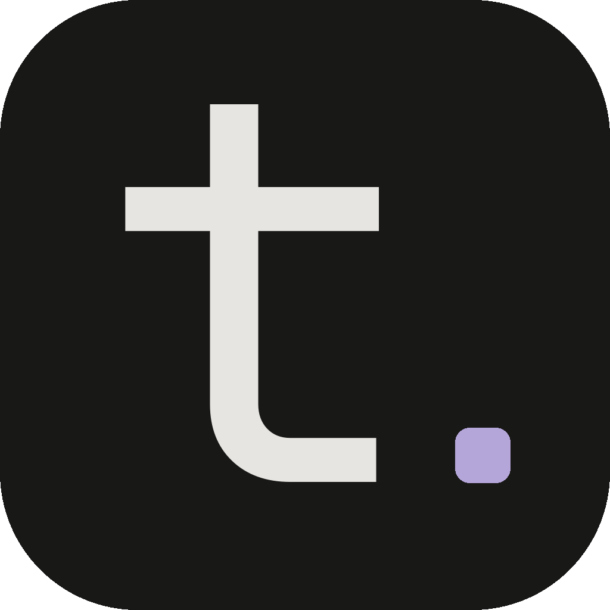

<p align="center"></p>

# type.

*a quiet place to write.*

Editor de notas para desktop (Windows), minimalista e rápido: abrir, escrever, fechar. Sem dashboards, sem contas, sem nuvem — suas notas são arquivos `.md` comuns numa pasta.

Feito em Kotlin + Compose Desktop.

## O que tem

- Notas em Markdown/texto, com **salvamento automático** e indicador de status.
- **Sidebar** agrupada por hoje, ontem, esta semana e antes; pesquisa por título e conteúdo.
- Criar, **renomear** e excluir (vai para a Lixeira, com confirmação); menu de clique direito.
- Contador de palavras e caracteres.
- Tema **soft dark / soft light** com transição suave.
- **Modo foco**: esconde a sidebar.
- **Ajustes**: fonte, tamanho, altura da linha e largura do editor.
- Exportar a nota como `.md` ou `.txt`.
- Reabre na última nota.

## Atalhos

| Atalho   | Ação        |
| -------- | ----------- |
| `Ctrl+N` | nova nota   |
| `Ctrl+S` | salvar      |
| `Ctrl+F` | pesquisar   |
| `Ctrl+\` | modo foco   |
| `Ctrl+,` | ajustes     |
| `F2`     | renomear    |

## Onde ficam os dados

Tudo em `Documentos\TYPE\` (segue o redirecionamento do OneDrive):

- `Notas\` — as notas, um arquivo por nota.
- `Lixeira\` — notas excluídas (nada é apagado de vez).
- `.type\settings.properties` — tema, fonte e última nota.

## Rodar e gerar o executável

Requer JDK 17.

```powershell
.\gradlew.bat run                 # abre o app
.\gradlew.bat test                # testes
.\gradlew.bat createDistributable # app portátil em composeApp\build\compose\binaries\main\app\TYPE
```

> Caminhos com `#` quebram partes do build: se o Gradle reclamar, rode de uma cópia em um caminho limpo (ex.: `C:\Temp\type`).

## Estrutura

```
composeApp/src/jvmMain/kotlin/app/type
├── data/    Note, NoteRepository, AppSettings
├── editor/  EditorState (autosave), Stats, Export
├── theme/   Colors, Theme, Typography, Motion (tokens)
└── ui/      Sidebar, Editor, TopBar, StatusBar, SettingsPanel, Dialogs
```

## Licença

Veja [LICENSE](LICENSE).
